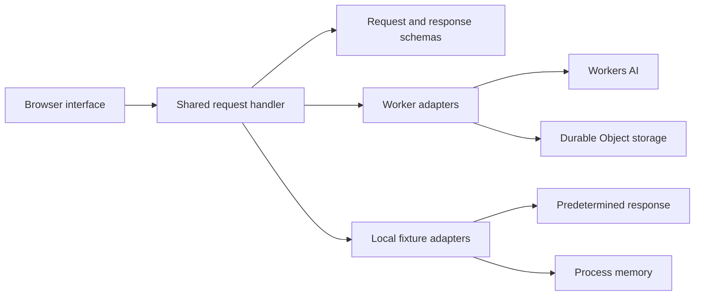

# Incident Triage Agent

An incident debugging interface with structured summaries, possible causes, next steps, and session history. The Cloudflare Worker uses Workers AI and Durable Objects. A separate local fixture mode demonstrates the application contract without a model account or inference calls.

## Browser preview

[Try the browser preview](https://owanden.github.io/demos/incident-triage/). Run the sample, simulate a provider failure, toggle status, or switch incident IDs. Responses are fixed examples, not generated findings. Use synthetic details only. No data leaves the tab; sessions live only in memory and reload clears them. This preview does not demonstrate a deployed Worker, model quality or durable storage.

Build with `npm run build:preview` after the locked installation below. Serve `dist/preview/` with a static HTTP server. The build bundles the existing browser UI with the shared request handler, schemas, fixture and in-memory transaction adapter. The production assets and Worker entry remain unchanged. A module allowlist rejects unexpected bundle inputs, and the generated page blocks network connections with `connect-src 'none'`. No service worker, local/session storage or external assets are used.

## Run the fixture demo

Requires Node.js 22 and npm. From a fresh checkout:

```sh
npm ci --ignore-scripts --no-audit --no-fund
npm run demo
```

Open http://127.0.0.1:8787/. The server binds to loopback and labels itself **Fixture demo**. It uses the same browser assets, request handler, validation and state transitions as the Worker, with a predetermined response and an in-memory store. It imports no Workers AI client and does not run Wrangler, load account credentials, or invoke a model. The locked package installation needs registry access; the running fixture needs no external service.

1. Leave the initial incident ID as `test`. Submit `Synthetic incident: timeout errors appeared after deployment.`
2. Inspect the structured response and updated overview. The summary explicitly says **Fixture response**; every valid submission returns the same fixture. These are not generated findings.
3. Activate the status button to mark the incident resolved. It is reachable with Tab and supports Enter or Space; its help text explains the toggle. Reload the page: conversation and status remain for that ID while the demo process stays running.
4. Submit `[simulate-provider-error]`. The UI reports `triage_unavailable`; the failed turn does not overwrite saved incident state. Reload to see only successful saved turns.
5. Choose **New Incident ID** to start a separate session. Stop with Ctrl+C; all fixture sessions are discarded. Set `DEMO_PORT` before startup if port 8787 is occupied.

Keyboard walkthrough: Tab through Incident ID, New Incident ID, Status, Incident details, and Send. Each control has a visible focus outline. Use Enter or Space on Status, then enter synthetic details and activate Send.

This walkthrough demonstrates UI/API behavior and failure handling, not model quality, real root-cause accuracy, or Durable Object durability. The separate automated storage check uses a local Workers runtime, not a deployed Cloudflare service.

## Architecture



The normal Worker entry remains `src/server.ts`. It supplies the real model and Durable Object adapters to `src/api.ts`. The fixture entry is `demo/server.ts`; neither the fixture response nor demo mode is selected by production requests. Static assets remain under `public/` and use the existing Wrangler asset configuration.

## Verify

```sh
npm test
npx wrangler deploy --dry-run --outdir dist/worker
```

Tests typecheck the Worker source, compile the standalone fixture, and check chat persistence, status-only updates, malformed requests, provider/output failures, storage errors, separate incident IDs, bounded recent evidence, delayed generation, overlapping chats, and real loopback fixture HTTP/assets. Browser-script regressions also delay state loads, chat replies/errors and status updates across incident switches, including returning to the same ID. Responses from an earlier visit cannot update the current view or its Send button. Switching views does not cancel or roll back a submitted server request; reload the original incident to inspect its saved result. A separate Wrangler local test exercises the actual Durable Object class and SQLite transactions with concurrent initialization, turn appends and status changes. Its test-only Worker has no AI binding and is never selected by the production configuration. No credentials or paid model calls are used. The pinned Wrangler runtime reports a local compatibility fallback from the configured 2026-03-10 to 2026-03-01; these checks do not establish behavior on the deployed platform. The dry run bundles the Worker without deploying it. GitHub Actions repeats the locked install, checks, and dry run on Node.js 22.

## API contract

- `GET /api/state?incidentId=test` loads a session. IDs contain 1..128 ASCII letters, digits, underscores, or hyphens; omission retains the `default` ID.
- `POST /api/chat` accepts only `incidentId` and a nonblank `message` capped at 8,000 characters. A successful structured response and both messages are appended together in a storage transaction after generation succeeds.
- `POST /api/state` accepts only `incidentId` and `status` (`open` or `resolved`). Clients cannot patch summary, messages, timestamps, or evidence through this endpoint.
- Invalid JSON/input returns 400; failed generation or invalid structured output returns 502; storage failure returns 503. Errors are JSON with fixed categories, without raw provider/storage exception messages. Unrecognized routes/methods return 404.

Generation uses a snapshot taken when the request starts, outside any storage transaction. Saving a successful turn rereads current state atomically, preserving status and other committed turns. Conversation pairs and evidence follow successful commit order; summary and hypotheses come from the last committed response, even if that request started earlier. Concurrent requests can therefore generate from the same older context. Failed generation commits no turn. This does not provide request deduplication or retry idempotency. The fixture serializes its in-memory transactions; the Worker uses Durable Object storage transactions.

The SDK also receives the output schema. Summaries, causes, steps and questions have bounded string lengths; output requires two or three possible causes and exactly three next steps.

## Cloudflare mode and limits

`npm run dev` still starts the existing Wrangler configuration and real Workers AI binding. It is distinct from the safe local fixture. Real inference requires separately configured Cloudflare access and may consume provider usage. No account setup, model request, remote deployment or inference-quality measurement was performed for the fixture checks.

The project has no authentication or authorization boundary; incident IDs are identifiers, not access controls. Full message history is retained without a retention policy, while prompts use recent conversation and the latest five distinct evidence entries. Sensitive-data redaction, model deadlines and durable retry behavior are not implemented. Use synthetic incidents for demonstrations.
